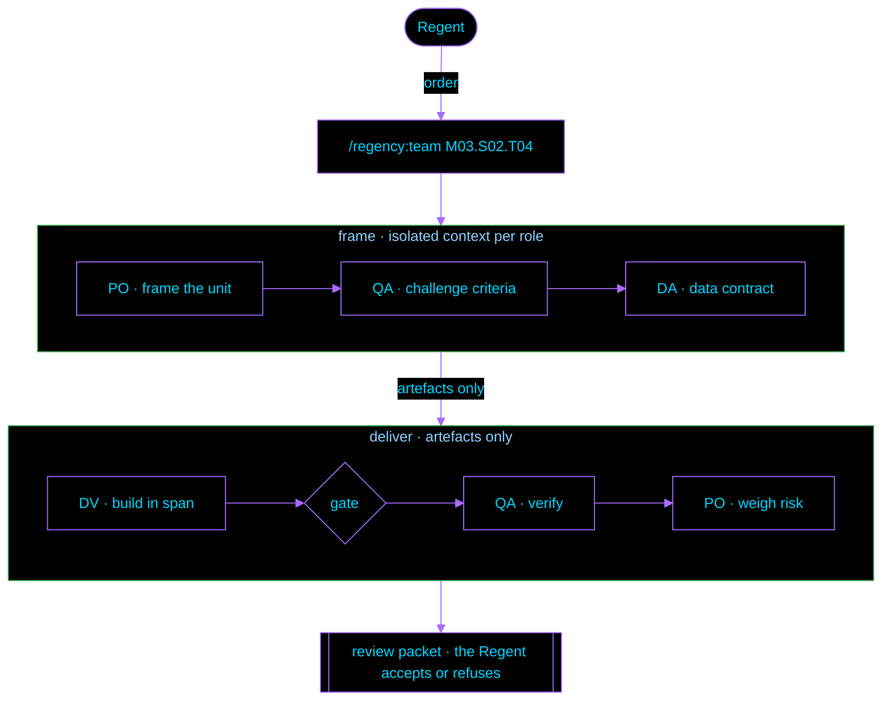

<p align="center">
  
</p>

<p align="center">
  <strong>An AI-first development harness for Claude Code.</strong><br>
  Isolated model roles, machine-checked contracts, runtime guards, and a human decision at every review packet.
</p>

<p align="center">
<!-- regency:badges:begin -->
  <a href="#versioning"></a>
  <a href="#api-surface"></a>
  <a href="#api-surface"></a>
<!-- regency:badges:end -->
  <a href="#requirements"></a>
  <a href="#requirements"></a>
  <a href="#requirements"></a>
  <a href="LICENSE"></a>
</p>

<p align="center">
  <a href="#installation"></a>
  <a href="#quick-start"></a>
  <a href="#api-surface"></a>
  <a href="#architecture"></a>
  <a href="library/REFERENCE.md"></a>
</p>

---

**Reference**: [`library/REFERENCE.md`](library/REFERENCE.md) · **Method**: [`library/team/ORCHESTRATION.md`](library/team/ORCHESTRATION.md) · **Conventions**: [`library/conventions.md`](library/conventions.md) · **Id grammar**: [`library/ids.md`](library/ids.md)

---

**regency** is a Claude Code plugin that runs software development as a governed loop. A human operator,
the **Regent**, issues orders. The model, **AA** (*Advanced Algorithm*), executes them as four isolated
roles (PO, DV, QA, DA) whose returns are validated against JSON contracts. Every unit of work ends in a
review packet that the Regent accepts or refuses.

Rules ship as data (a command registry, templates, return contracts) and are enforced by Python
standard-library scripts wired to Claude Code hooks. Design rule: *Mastery spares Synthesis*. Any decision
that can be fixed in advance is encoded as a script, a template, a registry entry or a hook, so the model
reads it instead of inferring it.

## Key features

- **Orchestrated team passes.** `/regency:team <unit>` declares who acts, dispatches PO, DV, QA and DA as
  subagents with isolated context, routes their returns, and stops at a review packet: declared span vs
  touched span, gate result, manifest diff, QA's risk opinion, then the diff.
- **Contracted returns.** Every subagent return is a JSON envelope checked by `scripts/returns.py`
  against its contract, then routed by governance order (G1 to the ledger, G2 and G3 to the Regent) by
  `scripts/gov.py`. A finding class that recurs is counted (`gov.py recur`).
- **Inference engines.** Five fixed protocols (`critical`, `causal`, `decision`, `control`, `clean`),
  invocable alone or inside a pass.
- **Orders.** Numbered, immutable work contracts: `germinate`, `handoff`, `dispatch`, `resume`, `lazy`.
- **Runtime guards.** Hooks deny pushes to `main`, unconfirmed cloud writes and rewrites of closed acts,
  and hold file writes after a destructive command. Guards fail closed.
- **Code-to-norm lineage.** Norm slices govern code paths. Every write re-fingerprints the file in a
  SQLite index and marks the governing slices `STALE` until the Regent checks them.
- **Version gate.** Each project carries a stamp. `/regency:update` migrates what regency owns on one
  approval, in a clean git tree, and never touches the project's own text.
- **Health checkup.** `/regency:health` runs 12 checks with the levels `FAIL`, `WARN`, `STALE`,
  `UNCHECKED` and `AOK`, plus per-project check sets the Regent ratifies.
- **Speed modes and automation.** Fuel-bounded team chains, `DRAFT/UNVERIFIED` drafts confined to
  `plumbing`, an auto-mode permission profile and headless routes.
- **Domain packs.** `/regency:pack adopt` takes any Claude Code plugin or skill as it is (skills, commands,
  agents, hooks, MCP servers) into regency's public `packs/` or a project's `.packs/`, switched on per
  project. A pack's hooks run through one dispatcher, only after the Regent ratifies them at the pack's
  fingerprint; a pack can add a guard, never remove one (`library/packs.md`).
- **Zero dependencies.** Python 3.8+ standard library, relative paths only, a relocatable folder.

## Installation

```bash
git clone https://github.com/Trevojan/regency.git

# one session
claude --plugin-dir ./regency

# user scope: the terminal, desktop local sessions and VS Code share it
claude plugin marketplace add ./regency
claude plugin install regency@regency
```

From GitHub, pinned to a release:

```bash
claude plugin marketplace add Trevojan/regency#v2.13
claude plugin install regency@regency
gh release verify v2.13        # the release is immutable and attested
```

> [!IMPORTANT]
> Pin a release tag. A pinned install never moves with `main`. Auto-update stays off until you turn it on
> (`/plugin` → Marketplaces), and an installed copy changes only when `.claude-plugin/plugin.json` changes
> its `version`. The only official source is `Trevojan/regency`.

> [!NOTE]
> Cloud sessions do not load local plugins. Download `regency-<version>.plugin` from
> [Releases](https://github.com/Trevojan/regency/releases) and check it with
> `gh release verify-asset v<version> regency-<version>.plugin`, or build it with `python scripts/package.py`.
> Then install it on the Claude account.

<details>
<summary><b>All seven install paths</b></summary>

<br>

| # | Path | Use when | Command |
|---|---|---|---|
| 1 | One session | trying it, or a machine you do not own | `claude --plugin-dir <path>` |
| 2 | Installed (user scope) | your own machine | `claude plugin marketplace add <path>` then `claude plugin install regency@regency` |
| 3 | Skills-directory plugin | auto-load in every session, no marketplace | copy or link the folder to `~/.claude/skills/regency/` (a managed allowlist may need `{"source":"skills-dir"}`) |
| 4 | Working directory | any agent, any version, no plugin loading | `cd <path> && claude`; `CLAUDE.md` orients the agent and the playbooks work as plain files |
| 5 | Added to another project | work on project X with regency at hand | `claude --add-dir <path>`, then: *read `<path>/CLAUDE.md` first* |
| 6 | A team | everyone on a repository gets it | in the project's `.claude/settings.json`: `{"extraKnownMarketplaces":{"regency":{"source":{"source":"github","repo":"Trevojan/regency"}}},"enabledPlugins":{"regency@regency":true}}` |
| 7 | Claude account | cloud sessions | `python scripts/package.py`, then install `dist/regency-<version>.plugin` on the account |

**Verified.** Claude Code 2.1.201: paths 1, 4 and 5 in live sessions, path 2 by `claude plugin validate`
plus an install in an isolated config, path 3 as a skills-directory plugin. Path 7 runs in Claude's cloud
sessions. Path 6 follows the documented settings shape and has not been run.

**Permissions.** A session whose working directory is a project reads regency's files from outside that
directory. In a headless run (`claude -p`) that read is denied unless granted: add `--add-dir <path>` or a
`Read(<path>/**)` rule. Interactively, Claude Code asks the first time.

</details>

## Quick start

```text
/regency doctor                       # the harness checks itself: every self-test, the wiring, portability
/regency:engine:critical "<claim>"    # run an inference engine; no project needed
/regency:init                         # scaffold .guidelines/ in the current repository
/regency:team M03.S02.T04             # one orchestrated pass over one task; stops at the review packet
/regency:health                       # every health check that applies here
```

A unit id is positional, never typed by hand: `M03.S02.T04 [F1–F3]` is module 3, step 2, task 4, with a
declared span over phases F1 to F3. A task is one code file. The grammar is machine-checked
(`library/ids.md`).

> [!TIP]
> Returning to a repository, `/regency:virtualpath:ongoing` reads the work ledger first: what is ongoing,
> drafted, in review, blocked or only backlog.

## Architecture



Roles exchange artefacts, never reasoning: QA never reads DV's explanation of why the code is right. DA
joins when the work touches data. A task that needs a phase outside its declared span stops and returns.

| Layer | Path | Role |
|---|---|---|
| Manifest | `.claude-plugin/` | `plugin.json`, `marketplace.json`; the folder is its own marketplace |
| Playbooks | `skills/<id>/SKILL.md` | one skill per command |
| Aliases | `commands/<id>/<sub>.md` | generated for `/regency:<id>:<sub>`; never edited |
| Doctrine and data | `library/` | registry, conventions, id grammar, role specs, return contracts, engines, Orders, templates, migrations |
| Engines | `scripts/` | standard-library Python: build, doctor, package, health, migrate, vp, idx, shortcuts, gov, returns, speed, station, ux, headless |
| Triggers | `hooks/hooks.json` | each hook runs one script in `scripts/`; no logic in the trigger |

Project-side state, under the project's guidelines root (`library/layouts.md`):

| Path | Holds | Tracked |
|---|---|---|
| `.shortcuts/.virtual/ongoing.json` | the work ledger: ongoing, draft, review, blocked, backlog | yes |
| `.shortcuts/.virtual/manifesto.json` | code-to-norm lineage slices | yes |
| `.shortcuts/.virtual/checkpoints.jsonl` | the checkpoint journal, OpenTelemetry GenAI keys | yes |
| `.shortcuts/.virtual/index.sqlite` | the exact index: nodes, fingerprints, edges | no (cache, rebuilt by `idx.py build`) |
| `.shortcuts/regency.json` | the version stamp read by the version gate | yes |
| `.shortcuts/.health/<part>.json` | ratified health check sets | yes |

## API surface

Every command, generated from `library/registry.json`; each name links to its playbook. Arguments and subcommand details:
[`library/REFERENCE.md`](library/REFERENCE.md#commands).

<!-- regency:modules:begin -->
| Command | Does | Subcommands |
|---|---|---|
| [`/regency`](skills/regency/SKILL.md) | Entry point: help, routing, doctor. | — |
| [`/regency:team`](skills/team/SKILL.md) | One orchestrated pass over one unit of work. | `declare` `status` `reopen` `extreme-go-horse` `just-in-time` |
| [`/regency:proceed`](skills/proceed/SKILL.md) | Work the whole queue. | — |
| [`/regency:arrange-cycle-commit`](skills/arrange-cycle-commit/SKILL.md) | Split the finished work into small, described commits, merge up to main following the project's branch contract, then push every branch except main. | — |
| [`/regency:measure-changes`](skills/measure-changes/SKILL.md) | Read-only: say what would change. | — |
| [`/regency:engine`](skills/engine/SKILL.md) | Run one of the five inference engines on a claim, plan, decision, system or repository. | `critical` `causal` `decision` `control` `clean` |
| [`/regency:role`](skills/role/SKILL.md) | Act as exactly one team role under its own contract. | `po` `dv` `qa` `da` |
| [`/regency:scribe`](skills/scribe/SKILL.md) | Call suba-scribe to write a text for the caller. | — |
| [`/regency:order`](skills/order/SKILL.md) | Fill and emit one of the four standard Orders from its template, as a numbered, immutable contract in the project. | `germinate` `handoff` `dispatch` `resume` `lazy` |
| [`/regency:init`](skills/init/SKILL.md) | Scaffold the .guidelines/ structure, CLAUDE.md and README in a project. | — |
| [`/regency:ux-init`](skills/ux-init/SKILL.md) | Scaffold the project's complete frontend documentation into the .ux/ folder of the guidelines root. | — |
| [`/regency:update`](skills/update/SKILL.md) | Bring a project to the installed regency. | `plan` `check` |
| [`/regency:pack`](skills/pack/SKILL.md) | Domain packs: adopt any Claude Code plugin or skill as it is into regency's packs/ or a project's .packs/, switch one on per project, ratify its hooks, run its playbooks. | `adopt` `run` |
| [`/regency:virtualpath`](skills/virtualpath/SKILL.md) | Query the code-to-norm lineage registry and the work ledger. | `code` `slice` `stale` `ongoing` `trace` `drafts` |
| [`/regency:tailwind-audit`](skills/tailwind-audit/SKILL.md) | Audit, fix or build a Tailwind frontend against a design-system norm. | — |
| [`/regency:station`](skills/station/SKILL.md) | Mise-en-place before a pass. | `check` `gate` `scaffold` `line` |
| [`/regency:health`](skills/health/SKILL.md) | The Regent's checkup, one line per finding with its method. | `project` `harness` `doctor` `shortcuts` `version` `copies` `distributable` `engines` `hooks` `queues` `context` `pipeline` |
| [`/regency:serious-doctor-appointment`](skills/serious-doctor-appointment/SKILL.md) | Assemble the caring topics of a project. | — |
<!-- regency:modules:end -->

`/regency:<id>:<sub>` and `/regency:<id> <sub>` run the same playbook. Without the plugin loaded, open
the playbook and follow it as a plain file.

## Runtime guarantees

| Guarantee | Enforced by |
|---|---|
| A push to `main` or `master` is denied in any form | `scripts/guard-push.py` |
| A cloud CLI write runs only if the Regent quoted that exact command in the current turn; reads pass | `scripts/hook-hazard.py`, `scripts/hook-verbs.py` |
| After a destructive command, file writes wait for a PO or QA permit or the Regent's release verb | `scripts/hook-hazard.py`, `scripts/hook-acts-guard.py` |
| Closed acts (Orders, gate sheets, ladder plans, dated handoffs) are never rewritten; `.scope/` is read-only | `scripts/hook-acts-guard.py` |
| Every write re-fingerprints the file and marks governing norm slices `STALE` | `scripts/hook-lineage.py` |
| Every subagent return is validated against its contract before it is routed | `scripts/hook-gov.py`, `scripts/returns.py` |
| A command that writes into a project first runs the version gate | `scripts/migrate.py` (`gate`) |
| Guards fail closed (`onFailure: block`); every hook self-tests under doctor and leaves a heartbeat | `scripts/doctor.py`, `/regency:health:hooks` |

Full hook reference: [`library/hooks.md`](library/hooks.md).

## Requirements

| Component | Version | Used for |
|---|---|---|
| Claude Code | 2.1.201 or later; 2.1.295 or later for guards that fail closed | plugins, skills, hooks |
| Python | 3.8 or later, on the PATH as `python` | every script and hook; standard library only |
| git | any recent | version gate, lineage, commits, the `copies` check |
| mise | optional | gate tasks for `/regency:station` |

Verified on Linux and Windows. On a Windows console, run doctor with `PYTHONUTF8=1`
(`library/maintaining.md`).

## Versioning

regency is versioned `a.b`: `+b` for a content change, `+a` for a major rule finished, reinterpreted or
invented, with no cap on either part. `library/registry.json` and `.claude-plugin/plugin.json` carry the
same value; doctor fails when they differ. A project behind the installed version is updated before
anything writes into it; a project ahead of it stops the session until the plugin is updated
(`library/migrations/README.md`).

Every version, the decisions behind it, the roadmap and where the work stands live in
[`.changelog/`](.changelog/README.md): start with `CHECKPOINT.md`.

## Development

```bash
python scripts/build.py            # regenerate aliases, command tables, README blocks and return templates
python scripts/doctor.py           # every self-test, the wiring, portability; exit 1 on any FAIL
python scripts/migrate.py record   # after a version bump that changed a template
python scripts/package.py          # dist/regency-<version>.plugin: allowlisted, deterministic
python scripts/install-automode.py # the auto-mode profile into ~/.claude/settings.json
python scripts/headless.py         # the headless routes (library/automation.md)
```

`library/registry.json` is the single source of truth for commands. Generated files (`commands/`, the
tables between `regency:` markers, the README blocks) are never edited by hand.

<details>
<summary><b>Terms</b></summary>

<br>

| Term | Meaning |
|---|---|
| Regent (`RGN`) | the human who decides; other humans carry a prefix (`RGN-PO`, `RGN-Client`) |
| AA | *Advanced Algorithm*: the model side of the work |
| PO · DV · QA · DA | agent roles: Product Owner, Developer, Quality Analyst, Data Analyst |
| Unit | `M##.S##.T##`: module, step, task; a task is one code file |
| Span | the phases a task may touch, `[F1–F3]` out of F0 to F6 |
| Gate | the mechanical check a change passes before any human reads it |
| Review packet | what a pass hands the Regent: span, gate, manifest diff, risk opinion, diff |
| Act | an immutable record: an Order, a gate sheet, a ladder plan, a dated handoff |
| Slice | a norm anchor that governs code paths (`manifesto.json`) |
| Ledger | `ongoing.json`: the state of every unit |
| Stamp | `.shortcuts/regency.json`: the regency version a project fits |

</details>

## Background

> [!NOTE]
> regency is the executable companion of *Hackiavelli — The Manual of Good Regency*, a manual in progress.
> A practice enters as a proposal and becomes a rule only after first-hand proof on the manual's own
> repository and the Regent's ratification.

## Contributing

Proposals carry evidence: a rule that failed on real work, a doubt that kept coming back, an instruction AA
needed twice. Read [`CONTRIBUTING.md`](CONTRIBUTING.md) before opening a pull request. Questions go to
[Discussions](https://github.com/Trevojan/regency/discussions); [`SUPPORT.md`](.github/SUPPORT.md) says
where everything else goes.

## Security

Hooks run on your machine, so a vulnerability is reported in private:
[Report a vulnerability](https://github.com/Trevojan/regency/security/advisories/new). Scope and what to
expect: [`SECURITY.md`](.github/SECURITY.md).

## License

[MIT](LICENSE) © 2026 Trevojan.

regency is an independent project, not affiliated with or endorsed by Anthropic. Claude and Claude Code are
products of Anthropic.
